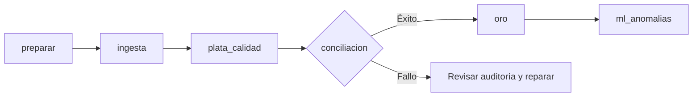

# DAG de la Entrega 2

| Tarea | Unidad de trabajo | Reintentos |
|---|---|---|
| `preparar` | Crear bronce, WPI y auditoría con permisos del grupo | 2 |
| `ingesta` | Publicar CSV completos y drenar archivos nuevos con el checkpoint persistente | 2 |
| `plata_calidad` | Una fecha a la vez, cuarentena original y conteos por regla | 1 |
| `conciliacion` | Verificar bronce = plata + cuarentena + duplicados válidos para cada fecha | 0 |
| `oro` | Reemplazar la fecha en trayectorias, presencia y dos matrices | 1 |
| `ml_anomalias` | Entrenar y registrar cuando se solicita, luego puntuar el día con una versión fija | 1 |

El Job admite una corrida activa. Lakeflow guarda las solicitudes adicionales en cola y evita dos escritores simultáneos sobre el checkpoint. Cada tarea usa la identidad propietaria de la corrida y se vincula por `existing_cluster_id`. El grupo tiene capacidad de solicitar y seguir corridas. La auditoría usa una fila por corrida y tarea, por lo que un reintento actualiza el resultado previo y los intentos individuales permanecen en Lakeflow.

La sesión se configura en UTC. El parámetro `fecha_proceso` apunta a un objeto diario en el archivo NOAA. El cron se interpreta en `America/Bogota`. La consola actualiza sus consultas al abrir el tablero o cambiar la fecha. El Job de verificación tiene un espacio de trabajo aislado para inyectar fallos sin contaminar los datos del DAG.

Definiciones en [DAB del pipeline](../../resources/jobs/oceanwatch_pipeline.job.yml) y [runbook](../runbook.md).
