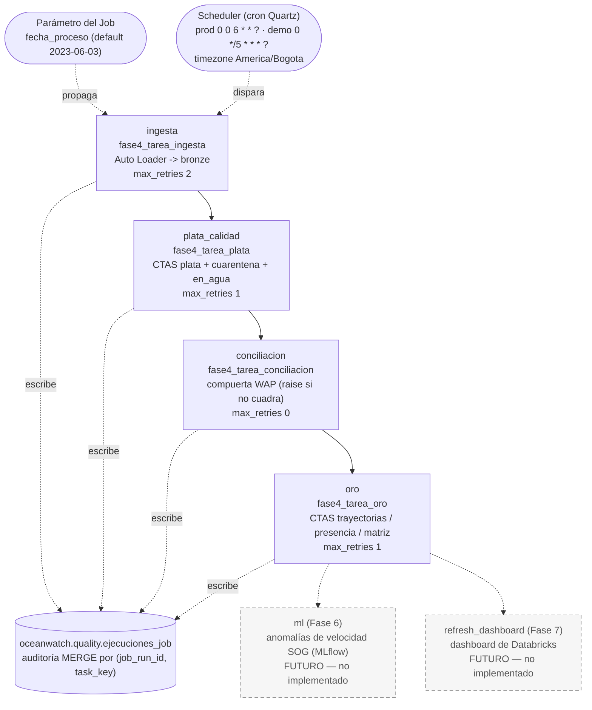

# Arquitectura — DAG de orquestación del Job (Fase 4, Req. 3)

Diagrama del grafo acíclico dirigido (DAG) del Job de Databricks
`oceanwatch_pipeline_entrega2` (`job_id` real `202547459111516`), definido como código
en [`resources/jobs/oceanwatch_pipeline.job.yml`](../../resources/jobs/oceanwatch_pipeline.job.yml)
(Databricks Asset Bundle; ver [ADR-013](../adr/ADR-013-diseno-job-orquestacion.md)).

Estado: **Verificado (ejecutado)** en Databricks serverless. Las 4 tareas corrieron de
verdad (corridas base/idempotencia/backfill en
[`evidence/req03-orquestacion/corridas_run_now.md`](../../evidence/req03-orquestacion/corridas_run_now.md)
y corridas automáticas por el scheduler en
[`evidence/req03-orquestacion/corridas_scheduled.md`](../../evidence/req03-orquestacion/corridas_scheduled.md)).

## Grafo de tareas

## Explicación del DAG

1. **Disparadores.** El Job se lanza por dos vías: manual (`databricks jobs run-now`,
   trigger `ONE_TIME`) o automática por el **scheduler** con un cron Quartz (trigger
   `PERIODIC`). El parámetro `fecha_proceso` (default `2023-06-03`) se propaga a las 4
   tareas vía `{{job.parameters.fecha_proceso}}` → `base_parameters` → `dbutils.widgets`.
   El backfill es simplemente pasar una fecha pasada (p. ej. `2023-06-01`).
2. **ingesta** → **plata_calidad** → **conciliacion** → **oro** es una cadena lineal
   (`depends_on` estricto). El linaje medallion impone el orden: no se puede materializar
   plata sin bronce, ni publicar oro sin haber conciliado la calidad.
3. **conciliacion** es la **compuerta Write-Audit-Publish (WAP)**: verifica el invariante
   `bronce = plata + cuarentena + duplicados` y hace `raise` si no cuadra, **fallando el
   Job antes de publicar oro**. Por eso tiene `max_retries: 0` (un invariante que no cuadra
   no es un fallo transitorio; ver [ADR-014](../adr/ADR-014-idempotencia-reintentos.md)).
4. **Auditoría.** Cada tarea escribe una fila en `oceanwatch.quality.ejecuciones_job` con
   `MERGE` idempotente por `(job_run_id, task_key)` — observabilidad por corrida y tarea.
5. **Reintentos por tarea** calibrados por la naturaleza del fallo: ingesta 2 (red NOAA +
   arranque serverless), plata 1, oro 1, conciliación 0.
6. **Nodos futuros** (punteados, **no implementados** en esta entrega): `ml` (Fase 6,
   detección de anomalías SOG con MLflow, ADR-005) y `refresh_dashboard` (Fase 7, dashboard
   de Databricks). Ambos colgarán de `oro` como nuevas tareas serverless. Su lugar está
   documentado como comentario en el YAML del Job.

## Relación con el resto de la arquitectura

El flujo de datos extremo a extremo (NOAA → landing → Auto Loader → bronce → plata/oro →
dashboard/ML) está en [`medallion-overview.md`](medallion-overview.md). Este documento se
centra en la **orquestación** de ese flujo: cómo el Job encadena las etapas, cuándo se
dispara y cómo se observa.
