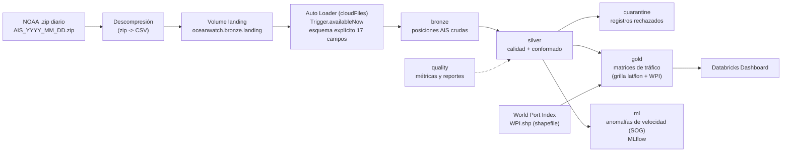

# Arquitectura — Vista general Medallion (OceanWatch Analytics, Entrega 2)

Diagrama editable del flujo de datos de extremo a extremo, desde el feed diario de NOAA hasta
el dashboard y el modelo de ML. Refleja las decisiones de ADR-001 (medallion serverless),
ADR-003 (ingesta zip → Auto Loader) y ADR-004 (Trigger.availableNow).

Estado: **Diseñado (no ejecutado)**. La materialización real de cada capa pertenece a Fase 2+.

## Explicación del flujo

1. **NOAA .zip diario.** La fuente oficial (Marine Cadastre / NOAA) publica un `.zip` por día
   con un CSV de posiciones AIS. El corpus de referencia es 1–7 de junio de 2023, pero el
   diseño admite fechas y archivos nuevos del feed (resiliencia requerida).
2. **Descompresión.** Spark y Auto Loader no leen `.zip` directamente (ADR-003); un paso previo
   descomprime el zip a CSV.
3. **Volume `landing`.** Los CSV descomprimidos aterrizan en `oceanwatch.bronze.landing`, la
   zona de aterrizaje que Auto Loader vigila.
4. **Auto Loader + Trigger.availableNow.** `cloudFiles` descubre incrementalmente los CSV
   nuevos, aplica el esquema explícito de 17 campos con columna de datos rescatados (evolución
   de esquema) y se dispara con `availableNow` (micro-batch que procesa lo disponible y se
   detiene), orquestado por un Job con cron en UTC (ADR-004).
5. **bronze.** Posiciones AIS crudas en Delta, con idempotencia `txnAppId`/`txnVersion`.
6. **silver.** Datos saneados y conformados tras las reglas de calidad; los registros que no
   las superan se desvían a **`quarantine`** (patrón dead-letter) y las métricas se registran
   en **`quality`**.
7. **gold.** Matrices de tráfico agregadas sobre la **grilla espacial por redondeo lat/lon**
   (NO H3, ADR-001), cruzadas con el **World Port Index** leído como shapefile (`WPI.shp`).
8. **Dashboard.** Un dashboard de Databricks consume las tablas de oro.
9. **ml.** La detección de anomalías de velocidad (SOG) consume features derivadas de silver y
   se versiona con MLflow (ADR-005).

> Las capas y volúmenes se crean con el bootstrap idempotente (ADR-002), hoy **PENDIENTE DE
> EJECUCIÓN**.
