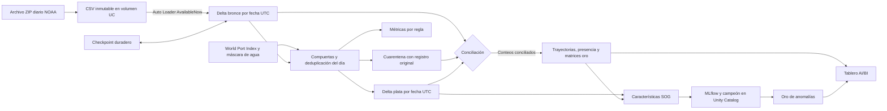

# Arquitectura institucional de OceanWatch

## Cómputo y almacenamiento

Las seis tareas usan el clúster clásico dedicado de Juan David. El clúster disponible es de un nodo `i3.xlarge`, con driver y ejecutores locales. Spark conserva el paralelismo por partición. Un ensayo en esta configuración mide poda, exchanges lógicos y una ejecución real de Spark, pero el coste de red y el escalamiento horizontal requieren un clúster con workers. El ID de cómputo se resuelve en despliegue y puede cambiarse para repetir el mismo DAG en otro clúster compatible.

El catálogo y esquema académicos disponibles son `clase14.equipo9`. Las capas comparten ese esquema con prefijos `oceanwatch_bronze_`, `oceanwatch_silver_`, `oceanwatch_quarantine_`, `oceanwatch_quality_`, `oceanwatch_gold_` y `oceanwatch_ml_`. El volumen `clase10.equipo9.checkpoints` se usa bajo una ruta exclusiva del proyecto, con landing y checkpoint en subárboles distintos. Las pruebas utilizan rutas independientes. El [ADR-019](../adr/ADR-019-computo-y-almacenamiento-institucional.md) documenta el acceso efectivo y los límites de segregación.

La fuente de hechos es el mensaje por `(MMSI, BaseDateTime)` en UTC. El día del archivo identifica el lote. Los timestamps que caen fuera de ese día van a cuarentena y se cuentan; esto mantiene disjuntos los espacios de claves para el backfill diario. Con la Entrega 1 se comparte la fuente pública, el esquema explícito, el diagnóstico de centinelas y la grilla de dos decimales. La prueba de almacenamiento de esa entrega motivó el filtro y partición por fecha para hechos voluminosos. Las tablas pequeñas usan el filtro de fecha y estadísticas Delta para evitar particiones físicas pequeñas.

## Coste y distribución

| Tramo | Trabajo y exchanges esperados | Decisión |
|---|---|---|
| Auto Loader | Parseo CSV paralelo y commits Delta | ZIP descomprimido por streaming de bytes en disco local. El stream usa el sink Delta directo y un checkpoint estable. |
| Geocalidad | Agregación de celdas distintas y broadcast de tres columnas | Una evaluación vectorizada sobre celdas, límite de 750.000 por día y fallo explícito si se excede. La máscara ráster vive una vez en el driver. |
| Plata | Una agregación por clave válida para conservar un representante y la multiplicidad | `max(struct(...))` determinista con preferencia de SOG real y fila sin rescate. Las reglas se miden con agregados condicionales de una sola pasada. Se reutiliza la clasificación en disco de Spark mientras se publican plata, cuarentena y métricas. |
| Trayectorias | Exchange por buque y día, orden temporal local y agregación por la misma llave | Ventanas nativas con `lag`, evitando coleccionar la trayectoria de cada buque al driver. |
| Presencia | Broadcast del WPI y agregación de coincidencias | Join por celda con 3.669 puertos, sin cruzar cada ping con todo el catálogo. |
| Matriz de tráfico | Redistribución por grilla/hora y conteo exacto de MMSI | Se mantiene el conteo exacto para el grano de negocio. El agregado diario lee el resultado horario ya compacto. |
| ML | Ventana por buque/día, broadcast por tipo y lotes Arrow | La muestra entrenada tiene límite estricto. La inferencia conserva las filas y produce una sola puntuación por mensaje en el ejecutor. |

Los planes `explain("formatted")` se imprimen en plata, oro y ML. AQE ajusta el número de particiones según tamaño y mantiene las redistribuciones necesarias para el orden y la unicidad. Consulte el Job de verificación para la medición del efecto de la poda. Bibliografía de ejecución y poda en el [ADR-020](../adr/ADR-020-procesamiento-incremental-y-calidad.md).
