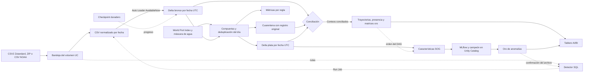

# Arquitectura institucional de OceanWatch

## Cómputo y almacenamiento

Las seis tareas usan el clúster clásico dedicado de Juan David, de un nodo `i3.xlarge`. Spark conserva el paralelismo por partición. La verificación en este entorno mide poda, exchanges lógicos y ejecución real de Spark. El coste de red y el escalamiento horizontal requieren un clúster con workers. El ID de cómputo se resuelve en despliegue y puede cambiarse para repetir el mismo DAG en otro clúster compatible. El warehouse SQL atiende la consola y las consultas de rutas del detector.

El catálogo y esquema académicos disponibles son `clase14.equipo9`. Las capas comparten ese esquema con prefijos `oceanwatch_bronze_`, `oceanwatch_silver_`, `oceanwatch_quarantine_`, `oceanwatch_quality_`, `oceanwatch_gold_` y `oceanwatch_ml_`. El volumen `clase10.equipo9.checkpoints` se usa bajo una ruta exclusiva del proyecto, con landing y checkpoint en subárboles distintos. Las pruebas utilizan rutas independientes. El [ADR-019](../adr/ADR-019-computo-y-almacenamiento-institucional.md) documenta el acceso efectivo y los límites de segregación.

La fuente de hechos es el mensaje por `(MMSI, BaseDateTime)` en UTC. El día del archivo identifica el lote. Para mantener disjuntos los espacios de claves del backfill diario, plata envía los timestamps de otro día a cuarentena y los cuenta. Con la Entrega 1 se comparte la fuente pública, el esquema explícito, el diagnóstico de centinelas y la grilla de dos decimales. La prueba de almacenamiento de esa entrega motivó el filtro y partición por fecha para hechos voluminosos. Las tablas pequeñas usan el filtro de fecha y estadísticas Delta para evitar particiones físicas pequeñas.

## Grilla y productos

La grilla WGS84 de **0,01°** conserva la resolución de la Parte 1. Redondear latitud y longitud permite cruzar por igualdad con WPI y agrupar con funciones nativas de Spark. H3 ofrece jerarquía y vecindades útiles para otros análisis. Para el mapa y el cruce de esta entrega, el redondeo mantiene comparabilidad y prescinde de una dependencia geoespacial adicional en ese tramo. Las celdas angulares varían en superficie con la latitud. El mapa interpreta intensidad como conteo de pings por celda y día.

Presencia exige al menos tres pings en la celda del puerto y día. El propósito es filtrar coincidencias breves de uno o dos reportes. Las trayectorias suman Haversine entre posiciones sucesivas de un mismo buque y día. El diseño usa una ventana nativa y preserva el orden temporal sin reunir cada serie en el driver. El [contrato](../data_contract_gold.md) fija los granos y los límites de interpretación.

## Coste y distribución

| Tramo | Trabajo y exchanges esperados | Decisión |
|---|---|---|
| Detector | Listado y comparación de rutas y marcadores | Las dos lecturas `binaryFile` se podan a `path`. Solo se llama al clúster clásico con entradas pendientes. |
| Auto Loader | Descompresión previa de un archivo, parseo CSV paralelo y commits Delta | La validación y normalización usan buffers acotados en disco temporal. El stream reutiliza el sink Delta directo y el checkpoint. |
| Geocalidad | Agregación de celdas distintas y broadcast de tres columnas | Una evaluación vectorizada sobre celdas, límite de 750.000 por día y fallo explícito si se excede. La máscara ráster vive una vez en el driver. |
| Plata | Una agregación por clave válida para conservar un representante y la multiplicidad | `max(struct(...))` determinista con preferencia de SOG real y fila sin rescate. Las reglas se miden con agregados condicionales de una sola pasada. Se reutiliza la clasificación en disco de Spark mientras se publican plata, cuarentena y métricas. |
| Trayectorias | Exchange por buque y día, orden temporal local y agregación por la misma llave | Ventanas nativas con `lag`, evitando coleccionar la trayectoria de cada buque al driver. |
| Presencia | Broadcast del WPI y agregación por MMSI, código de puerto y día | Se cruza por celda y se agregan claves pequeñas. Un segundo broadcast incorpora nombre, país y atributos al resultado, después del filtro de permanencia. |
| Matriz de tráfico | Redistribución por grilla/hora y conteo exacto de MMSI | Se mantiene el conteo exacto para el grano de negocio. El agregado diario lee el resultado horario ya compacto. |
| ML | Ventana por buque/día, broadcast por tipo y lotes Arrow | La muestra entrenada tiene límite estricto. La inferencia calcula una puntuación por mensaje elegible en el ejecutor y envía a oro las filas anómalas. |

Los planes `explain("formatted")` se imprimen en plata, oro y ML. AQE ajusta el número de particiones según tamaño y mantiene las redistribuciones necesarias para el orden y la unicidad. En la prueba de poda, ambas consultas devolvieron **2.637.032 pings**. El filtro de partición redujo de tres a un archivo y de **317.639.538** a **107.683.008 bytes** de huella de archivos. El plan de presencia mostró dos `BroadcastHashJoin` y una clave de agrupación reducida. [Medición y planes](../../evidence/institucional/#planes-spark) · [ADR-020](../adr/ADR-020-procesamiento-incremental-y-calidad.md).
